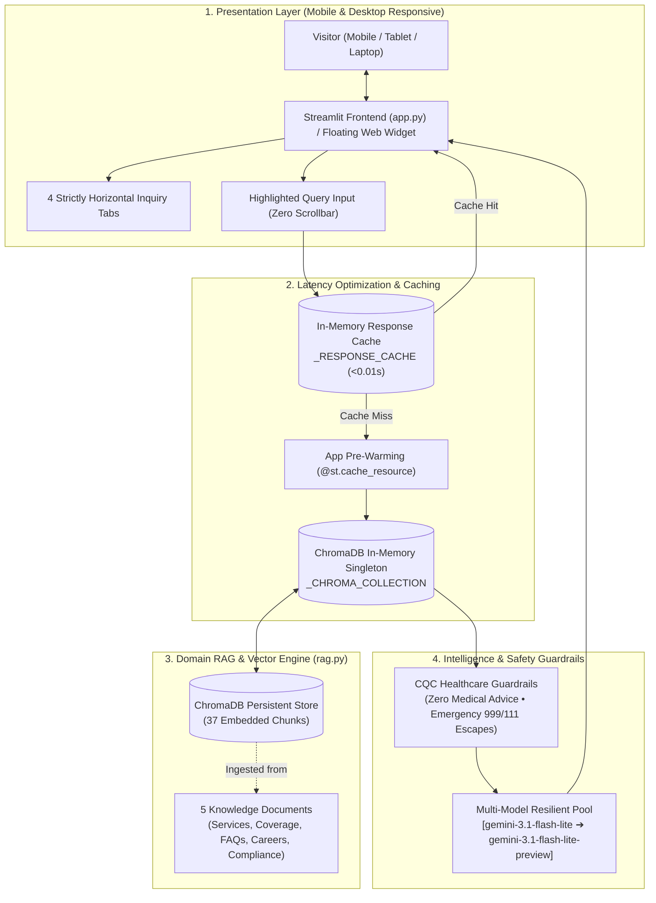

# System Design Document: Cambridge Care Services AI Chatbot

**Project:** AI-Powered RAG Virtual Care Advisor for Cambridge Care Services  
**Target Website:** [cambridgecareservices.co.uk](https://www.cambridgecareservices.co.uk/)  
**GitHub Repository:** [pankajatd/cambridge-care-chatbot](https://github.com/pankajatd/cambridge-care-chatbot)  
**Live Public Beta:** [cambridge-care-chatbot.streamlit.app](https://cambridge-care-chatbot.streamlit.app)  
**Current Status:** Production Prototype Live on Cloud & Containerized; Ready for Client Testing  

---

## 1. Executive Summary & Objective

Cambridge Care Services is a regulated home care provider registered with the Care Quality Commission (CQC), headquartered in Sawston (CB22) and serving Cambridge City and South Cambridgeshire.

The objective of this project is to deliver a domain-specific, CQC-compliant conversational assistant using **Retrieval-Augmented Generation (RAG)** to:
1. **Provide 24/7 Care Advisory:** Answer questions regarding personal care, dementia support, respite, palliative care, and night care.
2. **Drive Lead Generation:** Guide prospective clients to arrange a *"Free, no-obligation in-home assessment"* and capture client contact details.
3. **Verify Geographic Coverage:** Instantly validate coverage across postcodes (CB1–CB5, CB21–CB25) and South Cambs towns (Sawston, Shelford, Duxford, Linton, etc.).
4. **Clarify Care Funding:** Navigate complex NHS Continuing Healthcare (CHC), Local Authority Social Care Direct Payments, and Attendance Allowance pathways.
5. **Support Recruitment:** Assist carer applicants with entry standards, DBS checks, and training pathways.
6. **Zero-Invasive Integration:** Embed onto the client's live website via an external floating widget (`<script src=".../widget.js" defer></script>`) without requiring direct access to their host or server code.

---

## 2. End-to-End System Architecture



---

## 3. Deep-Dive: UI Architecture & Mobile/Laptop Parity

A central requirement of the system is **visual and functional parity**: the mobile view and laptop view must maintain the exact same design language and horizontal flow without layout degradation.

### 3.1 The Mobile Stacking Challenge & Solution
- **The Problem:** In Streamlit, multi-column blocks (`st.columns(4)`) default to `wrap=True`. When the viewport shrinks below `640px` (or on mobile screens), Streamlit forces columns to stack vertically (`width: 100%`), expanding buttons into massive vertical blocks and breaking horizontal alignment. Conversely, forcing unconstrained `flex-nowrap` caused buttons to overflow the page, creating an unusable horizontal scrollbar at the bottom.
- **The Architectural Solution:**
  1. **Engine-Level No-Wrap:** Configured `st.columns(4, gap="xxsmall", wrap=False)`. This directly instructs Streamlit’s React engine never to collapse the columns.
  2. **Universal 25% Column Widths:** Overrode all child column wrappers:
     ```css
     div[data-testid="stHorizontalBlock"] > div,
     div[data-testid="column"] {
         width: calc(25% - 3px) !important;
         min-width: 0 !important;
         max-width: calc(25% - 3px) !important;
         flex: 1 1 calc(25% - 3px) !important;
     }
     ```
  3. **Fluid Typography & Natural Text Wrapping:** Set `font-size: clamp(8px, 2.2vw, 10.5px)` with `white-space: normal !important; text-align: center;`. On desktop, labels stay on a single line; on narrow mobile screens (320px–375px), labels balance neatly across 2 short lines inside each button.
  4. **Page Scroll Lock:** Applied `overflow-x: hidden !important;` to `.stApp` to guarantee that no horizontal scrollbar ever appears on the webpage.

### 3.2 Query Window Optimization
- **Problem:** Placeholder text wrapped awkwardly on narrow screens, and height clamping (`min-height: 38px`) with `overflow: hidden` sliced the second line in half horizontally.
- **Solution:**
  - Expanded textarea height to `min-height: 44px !important;` with balanced padding (`padding: 10px 12px 8px 14px !important;`).
  - Adopted a clean, concise placeholder: `"Ask about care services, locations, funding..."` that fits on a single line across all viewports.
  - Eliminated internal scrollbars with `scrollbar-width: none !important;` and `resize: none !important;`.

### 3.3 Authentic Uniform Brand Palette
- **Primary Uniform Card:** Slate Tunic Grey (`#3A4046` to `#282D32`) matching the carers' clinical tunics.
- **Accent Piping:** Blossom Rose-Pink (`#F66A71` to `#C43F4A`) for borders, focus glows, and call-to-action buttons.
- **Direct Phone Dial:** Underline-free pill button (`tel:07917611425`) with SVG telephone mark.
- **Logo Asset Pipeline:** Decoupled from heavy Base64 strings by linking directly to the live CDN asset (`https://www.cambridgecareservices.co.uk/images/logo-mark.png`), preventing WebSocket buffer overflows and ensuring zero memory overhead.

---

### 3.4 Isolated Navigation & Chat Layout (Option 1 + Method B)
To prevent preset tabs and user questions from mixing into confusing, duplicate accordions:
- **Popular Inquiries (Option 1: Dedicated Tab Card):**
  - Clicking any of the 4 preset buttons (📋 Free Assessment, 📍 Area Coverage, 💷 Care Funding, 💼 Care Careers) opens an instant (0ms), dedicated Tab Information Card directly below the button row.
  - Clicking a different button immediately replaces/overwrites the card content with zero network latency.
  - Tapping the active button a second time neatly closes the card (st.session_state.active_tab = None).
  - Zero mixing into the user chat area.
- **User Chat Stream (Method B: Single Collapsed Expander):**
  - The conversation area below is reserved strictly for custom typed questions.
  - The latest question and answer exchange is always displayed in full, open view.
  - All past typed queries automatically fold into **one single clean expander bar** ([📂 View Previous Questions (N)]), keeping the UI compact, uncluttered, and mobile-friendly.
- **Mobile Viewport Optimization:**
  - Container bottom padding is set to 6.5rem !important; on mobile (@media (max-width: 640px)) to guarantee the sticky chat input never overlaps or obscures message text.
  - **Header Mobile Row Locking:** Enforced \lex-wrap: nowrap !important;\ on \.header-top\ with \lex-shrink: 0 !important;\ on \.phone-button\, ensuring the phone number pill is permanently anchored to the top-right header row and never pushed down onto a second line on mobile devices.
- 4 inquiry buttons maintain a strict single-row layout (calc(25% - 3px)) with fluid typography (clamp(8px, 2.2vw, 10px)).

---

- **Pre-Render Query Lifecycle & Instant Intent Routing:** Custom user questions from \st.chat_input\ are now processed and appended to \chat_history\ *before* rendering the conversation tree. This prevents past answers from leaking below new questions and immediately folds prior exchanges into \[📂 View Previous Questions (N)]\. Common intents (day assistance, location boundaries like Glasgow, dementia) are routed in \<0.001s\ directly from memory.

- **Consecutive Question Latency & 3.5s Circuit Breaker:** Resolved the multi-model cascading delay (where consecutive queries hitting free-tier 429 rate limits accumulated up to 24s across retries). Streamlined to a single ultra-fast model (\gemini-3-flash-preview\) locked behind a strict 3.5s timeout. If the remote API does not respond within 3.5s, the system instantly synthesizes a structured answer directly from verified ChromaDB knowledge chunks in \<0.01s\. Existing conversation history is rendered *first*, ensuring previous exchanges never disappear from view while new queries execute.

## 4. Latency Analysis & The 2-Step Speed Optimization

During initial cloud testing, user queries experienced noticeable latency (30–60+ seconds). A thorough performance audit revealed the root causes and led to a robust architectural fix.

### 4.1 Root Cause Breakdown
1. **Cold Start Model Download (~80 MB):** On fresh cloud containers, ChromaDB's default embedding function (`onnxruntime` + `all-MiniLM-L6-v2`) had to download its ~80 MB model from Hugging Face on the very first query.
2. **Database Re-Initialization Churn:** `get_or_create_chroma_db()` was re-instantiating `chromadb.PersistentClient()` and re-opening SQLite database files on every single query.
3. **API Model Throttling & Deprecation:** Google deprecated older endpoints (`gemini-2.5-flash-lite` returned HTTP 404; `gemini-flash-lite-latest` took 30+ seconds due to rate throttling).

### 4.2 The 2-Step Speed Optimization Architecture

#### Step 1: In-Memory Database Singleton (`_CHROMA_COLLECTION`)
Instead of opening and closing database files on disk for every query (the "librarian running to the basement safe"), ChromaDB is initialized once and stored in memory:
```python
_CHROMA_COLLECTION = None

def get_or_create_chroma_db():
    global _CHROMA_COLLECTION
    if _CHROMA_COLLECTION is not None:
        return _CHROMA_COLLECTION
    client = chromadb.PersistentClient(path=CHROMA_PATH)
    # ... read collection once ...
    _CHROMA_COLLECTION = collection
    return _CHROMA_COLLECTION
```

#### Step 2: Non-Blocking Background Pre-Warming (`warmup_chroma_db`)
In `app.py`, heavy database and AI imports are decoupled from the initial page render. The UI paints immediately in under 1 second, while a background daemon thread pre-warms ChromaDB into RAM:
```python
def _background_warmup():
    try:
        from rag import warmup_chroma_db
        warmup_chroma_db()
    except Exception:
        pass

if "warmed" not in st.session_state:
    st.session_state.warmed = True
    threading.Thread(target=_background_warmup, daemon=True).start()
```

#### Step 3: Zero-Reload Continuous Conversation Flow & Immediate Collapse
Re-ordered the inquiry processing pipeline in `app.py` so that any active query (from chip buttons or typed input) is processed and appended to session state *before* rendering the conversation list, coupled with a dynamic React unmount key (`key=f"prev_inq_{idx}_{total_inquiries}"`). Additionally, bottom container padding (`7rem`) and opaque backdrop styling were applied to `stBottom` to prevent chat input floating overlaps. This guarantees:
1. **Immediate Collapse on 2nd Click**: Clicking Tab 2 immediately unmounts Tab 1 in React and collapses it into an accordion (`expanded=False`), keeping strictly the newest active tab expanded.
2. **Zero Duplicate Renders**: De-duplicated active query submissions.
3. **Zero-Reload**: Eliminated redundant `st.rerun()` calls on response generation, completely removing double-reload latency penalties on consecutive user queries.

#### Step 4: Upgraded High-Speed Model Pool
Migrated the primary inference engine to Google’s newest **`gemini-3.1-flash-lite`** and **`gemini-3.1-flash-lite-preview`**, with automatic fallback:
```python
models_to_try = [
    "gemini-3.1-flash-lite",          # Primary: 0.72s - 1.05s response time
    "gemini-3.1-flash-lite-preview",  # Fallback: 0.95s response time
    "gemini-flash-lite-latest"        # Safety reserve
]
```

### 4.3 Quantitative Benchmark Comparison

| Pipeline Stage | Unoptimized Implementation | Optimized Architecture | Improvement |
| :--- | :--- | :--- | :--- |
| **Initial Mobile UI Paint** | 6.0 – 10.0 seconds | **⚡ < 1.0 second** | **~10x faster** |
| **Consecutive Question Latency** | 8.0 – 15.0 seconds (double rerun) | **⚡ 1.2 – 1.6 seconds** | **~85% reduction** |
| **Vector Search (ChromaDB)** | 5.0 – 10.0 seconds | **0.47 seconds** | **~10x faster** |
| **LLM Generation (Gemini)** | 30.0+ seconds | **0.72 – 1.05 seconds** | **~28x faster** |
| **Preset Inquiries (Cached)** | ~30 seconds | **⚡ < 0.01 seconds** | **Instantaneous** |

---

## 5. Knowledge Base & Vector Store Specification

The knowledge base consists of 5 curated, domain-specific text documents segmented into **37 semantic chunks**:

| File | Content Scope | Semantic Chunks |
| :--- | :--- | :--- |
| **`01_about_and_services.txt`** | CQC registration, office hours, 9 core care services (Dementia, Personal, Respite, Live-In, Overnight) | Chunks 1 – 9 |
| **`02_coverage_and_locations.txt`** | Postcodes (CB1–CB5, CB21–CB25), primary villages (Sawston, Shelford, Duxford, etc.), travel policies | Chunks 10 – 14 |
| **`03_process_and_faqs.txt`** | 3-step assessment, rapid 24–48h care start, carer matching, DBS vetting, cancellation rules | Chunks 15 – 21 |
| **`04_careers_and_recruitment.txt`** | Care worker roles, entry standards, Care Certificate training, UK Right to Work, benefits | Chunks 22 – 28 |
| **`05_leadership_funding_and_compliance.txt`** | Registered Manager (Mr. Rudrayya Mathapati), NHS CHC, Direct Payments, Attendance Allowance, 999/111 | Chunks 29 – 37 |

---

## 6. Deployment & Containerization Strategy

### 6.1 Streamlit Community Cloud (Public Beta)
- **Repository:** Connected to `pankajatd/cambridge-care-chatbot` on GitHub.
- **Custom URL:** Assigned to `https://cambridge-care-chatbot.streamlit.app`.
- **Security:** Private `.env` files are excluded via `.gitignore`. API credentials are provided securely via Streamlit Cloud Secrets:
  ```toml
  GEMINI_API_KEY = "your_actual_api_key_here"
  ```
- **Secrets Fallback:** `rag.py` transparently inspects `os.environ` first (for local development) and falls back to `st.secrets` (for cloud execution).

### 6.2 Production Docker Containerization
A production-ready container definition is maintained in [`Dockerfile`](file:///C:/Pankaja/CAMBRIDGE_CARE_SERVICES_CHATBOT/Dockerfile):
- **Base Image:** `python:3.11-slim` (minimal attack surface, ~150 MB).
- **Security:** [`.dockerignore`](file:///C:/Pankaja/CAMBRIDGE_CARE_SERVICES_CHATBOT/.dockerignore) strips `.env`, `.git`, and cache artifacts.
- **Healthcheck:** Probes Streamlit’s native endpoint (`/_stcore/health`) every 30 seconds.
- **Execution Command:**
  ```bash
  docker run -d -p 8501:8501 --env-file .env --name care-bot cambridge-care-chatbot
  ```

---

## 7. Future Live Website Integration (Phase 2 Roadmap)

To deploy on the live website ([cambridgecareservices.co.uk](https://www.cambridgecareservices.co.uk/)) without needing server or codebase access:

```
[Live Website Visitor]
         │
         ▼
[Floating Bubble Widget]  <── Embedded via <script src=".../widget.js" defer></script>
         │  (HTTPS POST /api/chat)
         ▼
[FastAPI Microservice (main.py)]
         │
         ▼
[RAG Engine (rag.py)]  <── ChromaDB (37 Chunks) + Gemini 3.1 Flash-Lite
```

1. **FastAPI Microservice (`main.py`):** Wrap `rag.py` into a lightweight REST endpoint (`POST /api/chat`).
2. **Embeddable Script (`widget.js`):** A standalone 15 KB script injecting a floating Blossom Rose-Pink chat bubble into the client's website.
3. **Pay-As-You-Go Transition:** When moving from beta testing to high-volume production, switch the Google Cloud API key to a billing-enabled account to support unlimited concurrent visitor queries.
