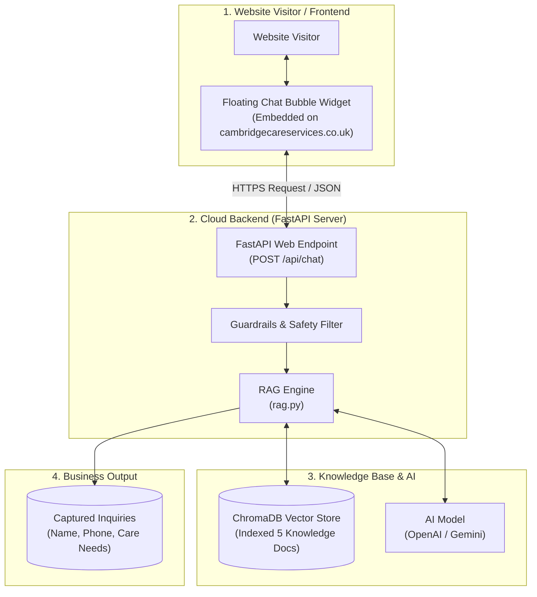
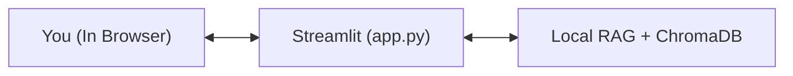
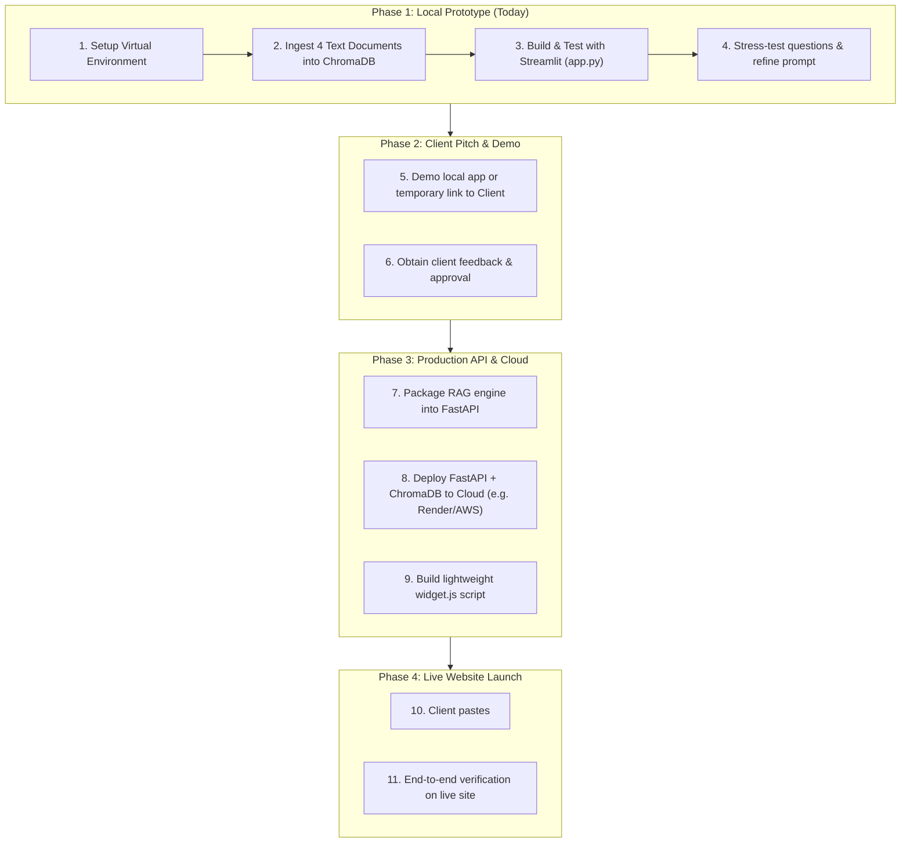

# System Design Document: Cambridge Care Services AI Chatbot

**Project:** AI-Powered RAG Chatbot for Cambridge Care Services  
**Target Website:** [cambridgecareservices.co.uk](https://www.cambridgecareservices.co.uk/)  
**Document Author:** Freelance AI Engineering Plan  
**Status:** Under Client & Developer Review (No implementation until approved)  

---

## 1. Executive Summary & Objective

Cambridge Care Services is a regulated home care provider registered with the Care Quality Commission (CQC) in Cambridge and South Cambridgeshire.

The goal of this project is to build an intelligent, domain-specific AI Chatbot using **RAG (Retrieval-Augmented Generation)** to:
1. Provide instant 24/7 answers to prospective clients regarding care services, costs/funding, and geographic coverage.
2. Act as a **Lead Generation Engine** by collecting inquiries and phone numbers for free home assessments.
3. Assist job seekers with recruitment criteria and application procedures.
4. Seamlessly embed onto the live website **without needing access to their proprietary codebase or servers**.

---

## 2. Overall Architecture Blueprint

The project follows a 2-stage decoupled architecture:
1. **Development & Testing Phase:** 100% self-contained on your local computer using **Streamlit**.
2. **Production & Integration Phase:** Hosted on a cloud server using **FastAPI**, embedded onto the client's website via a single JavaScript snippet.



---

## 3. Deep Dive: Component by Component

### Component A: The Knowledge Base (The 5 Documents)
Your knowledge base is prepared in `C:\Pankaja\CAMBRIDGE_CARE_SERVICES_CHATBOT`:
* **`01_about_and_services.txt`**: CQC registration, office hours, contact details, 9 distinct care offerings (Personal Care, Dementia, Live-In, Respite, Night Care, etc.).
* **`02_coverage_and_locations.txt`**: Postcodes (CB1–CB5, CB21–CB25), villages, and out-of-area policies.
* **`03_process_and_faqs.txt`**: 3-step onboarding, rapid 24–48h start, DBS checks, funding options (Direct Payments, NHS Continuing Healthcare, Private).
* **`04_careers_and_recruitment.txt`**: Job roles, DBS checks, driving requirements, UK Right to Work, application pathways.
* **`05_leadership_funding_and_compliance.txt`**: Registered Manager (Mr. Rudrayya Mathapati), CQC registration history (since March 2022), Cambridgeshire County Council assessments, Attendance Allowance, 999/111 emergency protocols, and review platforms.

---

### Component B: The Vector Database (ChromaDB)
* **What it does:** ChromaDB reads the 4 text documents, splits them into semantic paragraphs, and converts them into mathematical vectors (embeddings).
* **Where it lives:**
  * **Locally:** In a folder named `./chroma_db` inside your workspace folder on your `C:` drive.
  * **In Production:** In that same `./chroma_db` folder hosted on the cloud server.
* **Why it is necessary:** It guarantees that answers are grounded strictly in Cambridge Care Services' verified facts, preventing hallucinations.

---

### Component C: Streamlit (Stage 1 - Local Standalone Testing)
* **Purpose:** Allows you to test, debug, and demo the chatbot completely on your laptop with a graphical user interface.
* **How it works:**
  * One single Python file: `app.py`.
  * Runs via `streamlit run app.py`.
  * Automatically opens a browser tab with a chat box, branding, and interactive responses.
  * It directly imports the RAG engine and ChromaDB.
  * **No internet hosting, no cloud server, and no FastAPI required in this phase.**



---

### Component D: FastAPI (Stage 2 - The Production Engine)
* **Purpose:** Acts as the communication bridge between the live public website and your Python RAG logic.
* **Why we introduce FastAPI here:**
  * The client's live website cannot run Python scripts directly.
  * FastAPI is a high-performance web framework that receives questions sent over the internet as JSON:
    ```json
    { "message": "Do you provide care in Linton?" }
    ```
  * It hands the message to `rag.py`, gets the generated answer, and returns:
    ```json
    { "reply": "Yes! Cambridge Care Services covers Linton under postcode CB21..." }
    ```

---

### Component E: Cloud Hosting (Independent of the Client's Host)
* **The Key Principle:** **The chatbot server and the client's website do NOT need to be on the same cloud.**
* Cambridge Care Services' website can be hosted anywhere (Wix, WordPress, GoDaddy, AWS, etc.).
* Your chatbot backend runs independently on a cloud platform (such as **Render**, **Railway**, or **AWS EC2/App Runner**).
* The cloud server stays on 24/7, ready to answer questions sent from the website.

---

### Component F: Integration with the Live Website (Zero Codebase Access Needed)
Because you do not have their frontend or backend source code, integration is handled using the **Widget Embedding Method** (the standard way Intercom, Zendesk, and Drift operate).

#### How it works:
1. You provide the website owner with **one single script line**:
   ```html
   <!-- Cambridge Care Services AI Chatbot Widget -->
   <script src="https://your-chatbot-server.com/widget.js" defer></script>
   ```
2. The website administrator pastes this into their website's header or footer settings (or inside WordPress Theme Settings / Google Tag Manager).
3. **The Result:**
   * A circular chat bubble automatically appears at the bottom-right corner of their live website.
   * Clicking the bubble opens the branded Cambridge Care Services chat window.
   * It is 100% responsive on both mobile phones and desktop computers.

---

## 4. Safety Guardrails & Lead Generation

### 1. Safety Guardrails (Strict Healthcare Compliance)
* **Medical Advice Guardrail:** The bot will clearly state it provides non-clinical home care and direct any clinical/medication queries to the client's GP or District Nurse.
* **Out-of-Scope Guardrail:** Questions about politics, non-care topics, or general knowledge are politely redirected back to Cambridge Care Services topics.
* **Geographic Accuracy:** If an unknown town is asked about, it refers to the 07917 611 425 helpline rather than making false commitments.

### 2. Lead Capture Workflow
* When a visitor expresses interest in care, the bot prompts:
  > *"We would be delighted to arrange a free, no-obligation home assessment. May I take your name and contact phone number so our care team can reach out?"*
* Contact details are captured and logged (or emailed directly to `info@cambridgecareservices.co.uk`).

---

## 5. Phased Project Roadmap



---

## 6. What Needs Your Approval to Begin

To start **Phase 1** (completely on your laptop, zero cloud setup, zero cost):
1. **Review and approve this design document.**
2. **Confirm your preferred AI model provider:**
   * **OpenAI** (e.g., `gpt-4o-mini` - very cheap, fast, high quality).
   * **Google Gemini** (via Gemini API).
   * **Local / Open-Source** (e.g., Ollama - completely free, runs on your hardware).
