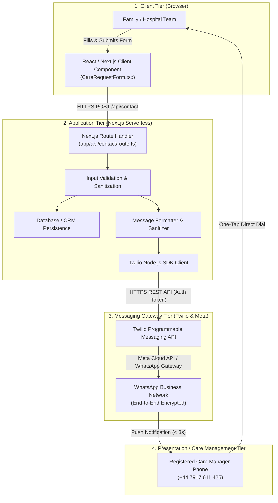
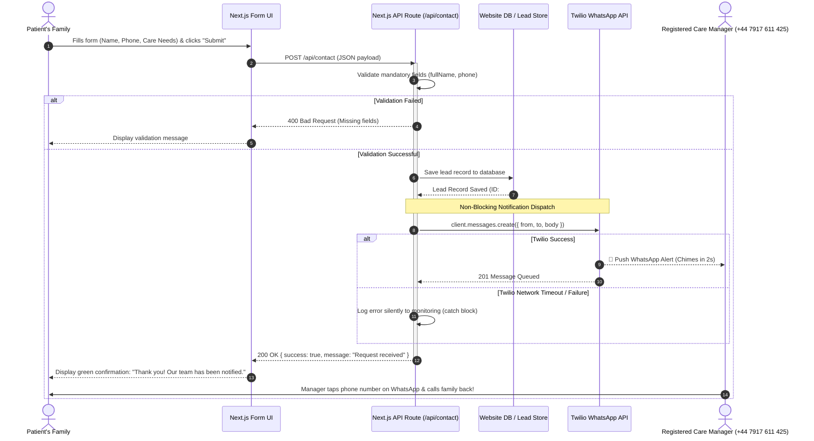
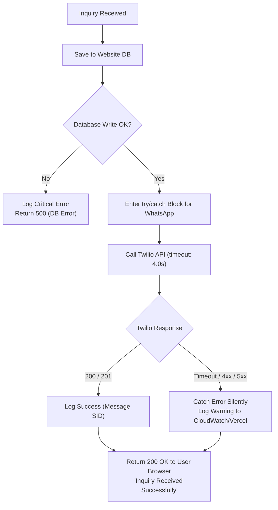

# System Design Document: WhatsApp Lead Notification Module

**Project:** Cambridge Care Services Virtual Infrastructure  
**Client / Domain:** Cambridge Care Services (`cambridgecareservices.co.uk`)  
**Component:** Real-Time Lead Ingestion & WhatsApp Notification Engine  
**Version:** 1.0.0 (Production Architecture)  
**Status:** Approved for Implementation  
**Recipient Endpoint:** Registered Care Manager (+44 7917 611 425)

---

## 1. Executive Summary & Business Context

### 1.1 The Challenge
In UK domiciliary and specialized home care (dementia, post-stroke reablement, palliative care), families often submit care inquiries during times of acute vulnerability—such as an impending hospital discharge or rapid decline in a loved one's mobility. Industry benchmarks indicate:
* Inquiries responded to within **10 to 15 minutes** achieve an **80% higher conversion rate** into active care assessments.
* Standard email-based notifications often sit unread in inboxes for hours or overnight, leading families to contact competing care agencies.

### 1.2 The Solution
The **WhatsApp Lead Notification Module** is a lightweight, server-side event-driven notification pipeline integrated directly into the `cambridgecareservices.co.uk` **Next.js** infrastructure. Upon submission of any care inquiry or assessment request form, the backend dispatches an encrypted, structured WhatsApp alert to the Registered Care Manager's mobile phone within **2 to 3 seconds**, featuring a direct one-tap callback shortcut.

---

## 2. Requirements & Constraints

### 2.1 Functional Requirements (FR)
* **FR-1 (Ingestion):** Accept multi-field care inquiries from the website front-end (Full Name, Phone, Email, Postcode, Care Type, Visit Schedule, Required Start Date, and Notes).
* **FR-2 (Validation):** Perform strict server-side validation on mandatory intake fields (Name, Phone number).
* **FR-3 (Transformation):** Format raw JSON payloads into a clean, human-readable WhatsApp message using bold headings, emojis for rapid visual scanning, and phone dialing shortcuts.
* **FR-4 (Dispatch):** Transmit the formatted alert to the Registered Manager's WhatsApp number (`+44 7917 611 425`) via the Twilio Messaging API.
* **FR-5 (Resilient Feedback):** Return an immediate confirmation response (`200 OK`) to the user's browser, regardless of external messaging gateway status.

### 2.2 Non-Functional Requirements (NFR)
* **NFR-1 (Latency):** Total end-to-end latency from form button click to phone notification must be **< 3.0 seconds**.
* **NFR-2 (Availability & Reliability):** 99.9% uptime. Form submissions must **never fail or display error screens** to users due to downstream messaging delays.
* **NFR-3 (Security & GDPR):** All transmissions must use TLS 1.3 and Signal Protocol End-to-End Encryption (E2EE). API secrets must strictly reside in server-side environment variables.
* **NFR-4 (Data Minimization):** Only basic operational contact data required to initiate a care phone call is transmitted over WhatsApp; sensitive EHR/medical diagnoses remain protected in core database storage.

---

## 3. High-Level System Architecture



---

## 4. End-to-End Execution Sequence



---

## 5. Component Specifications & Data Contracts

### 5.1 Inbound Payload Schema (Website $\rightarrow$ Next.js Server)

```json
{
  "$schema": "http://json-schema.org/draft-07/schema#",
  "title": "CareInquiryPayload",
  "type": "object",
  "properties": {
    "fullName": { "type": "string", "minLength": 2, "maxLength": 100 },
    "phone": { "type": "string", "minLength": 10, "maxLength": 20 },
    "email": { "type": "string", "format": "email" },
    "postcode": { "type": "string", "maxLength": 10 },
    "careType": { "type": "string", "enum": ["Dementia Care", "Parkinson's Support", "Post-Stroke Reablement", "Overnight Care", "Respite Care", "Personal Care", "General Inquiry"] },
    "schedule": { "type": "string" },
    "startDate": { "type": "string" },
    "notes": { "type": "string", "maxLength": 1000 }
  },
  "required": ["fullName", "phone"]
}
```

### 5.2 Outbound Twilio API Payload

* **HTTP Method:** `POST`
* **Endpoint:** `https://api.twilio.com/2010-04-01/Accounts/{AccountSid}/Messages.json`
* **Authentication:** HTTP Basic Auth (`TWILIO_ACCOUNT_SID` : `TWILIO_AUTH_TOKEN`)
* **Headers:** `Content-Type: application/x-www-form-urlencoded`
* **Body Parameters:**
  * `From`: `whatsapp:+14155238886` (Twilio WhatsApp Sandbox or verified Business Number)
  * `To`: `whatsapp:+447917611425`
  * `Body`: Interpolated notification text.

### 5.3 Rendered WhatsApp Message Template

```text
🚨 *NEW CARE INQUIRY — Cambridge Care Services*

👤 *Contact:* Sarah Jenkins (Daughter)
📞 *Phone:* 07912 345 678
📧 *Email:* s.jenkins@example.co.uk
📍 *Location:* Great Shelford (CB22 5NE)
🩺 *Care Needs:* Post-stroke rehabilitation & mobility assistance
⏰ *Schedule:* Daytime visits + 6-hour night
📅 *Start Date:* Urgent (Hospital Discharge this Friday)
💬 *Notes:* Requesting a male carer for personal care routines.

👉 *Tap phone number above to call family immediately.*
```

---

## 6. Resilience, Error Handling & Fault Tolerance



### Key Safety Mechanisms:
1. **Separation of Concerns:** The database write occurs **before** the WhatsApp call. Even if the internet connection to Twilio drops, the family's submission is never lost.
2. **Circuit Protection (`try/catch`):** Any network timeout or Twilio rate limit is caught in the catch block. The route gracefully completes and returns `200 OK` with a success message to the client's browser.
3. **Timeout Clamping:** The external API call is bounded by a **4.0-second timeout** to ensure the serverless function does not hang or exceed Vercel/Next.js execution ceilings.

---

## 7. Security, Privacy & CQC / GDPR Compliance

1. **Server-Side Secret Isolation:**  
   The `TWILIO_AUTH_TOKEN` is strictly stored in server-side environment variables (`.env.local` / Vercel Secrets). It is **never** bundled into client-side JavaScript or visible in browser developer tools.
2. **Signal Protocol End-to-End Encryption:**  
   WhatsApp messages are encrypted at the transport and application layers using the Signal Protocol, preventing interception over public cellular networks.
3. **Data Minimization (GDPR Article 5(1)(c)):**  
   The WhatsApp alert contains strictly operational contact data needed to make a phone call. Comprehensive medical records, Medication Administration Records (MAR), and full clinical histories are collected securely during the in-person home assessment conducted by the Registered Care Manager.
4. **Access Control:**  
   The recipient number is hardcoded to the registered, device-locked phone of the Registered Manager (`+44 7917 611 425`).

---

## 8. Cost Analysis & Operational Economics

| Component | Provider | Cost Basis | Estimated Monthly Cost |
| :--- | :--- | :--- | :--- |
| **Messaging Infrastructure** | Twilio Messaging API | Pay-as-you-go | £0.00 base subscription |
| **Signup Credit** | Twilio | Free Trial | **+$15.00 (£12.00)** credit upon account creation |
| **UK WhatsApp Dispatch Rate** | Twilio / Meta Cloud | ~£0.035 per message | £1.75 / month (for 50 live inquiries) |
| **Hosting & Execution** | Next.js Serverless | Included in existing host | £0.00 additional |
| **Total Operational Cost** | &mdash; | &mdash; | **~£1.50 &ndash; £3.50 / month** |

---

## 9. Deployment Runbook & Verification Checklist

### Pre-Deployment
- [ ] Create Twilio account and activate WhatsApp Sandbox or Business Sender.
- [ ] Add `TWILIO_ACCOUNT_SID`, `TWILIO_AUTH_TOKEN`, `TWILIO_WHATSAPP_SENDER`, and `CARE_MANAGER_WHATSAPP_NUMBER` to `.env.local` and Vercel/hosting dashboard.
- [ ] Run `npm install twilio` in the project root.

### Testing & Verification
- [ ] **Unit Test:** Submit a mock JSON payload locally to `http://localhost:3000/api/contact`. Verify `200 OK` response.
- [ ] **Notification Test:** Confirm phone `+44 7917 611 425` chimes within 3 seconds with the formatted alert.
- [ ] **Dialer Test:** Tap the phone number link inside the WhatsApp message to verify native mobile dialer triggers correctly.
- [ ] **Resilience Test:** Temporarily invalidate the Twilio auth token and submit the form. Verify the website form still reports success to the user without crashing.

### Post-Deployment
- [ ] Verify live production form on `https://www.cambridgecareservices.co.uk/`.
- [ ] Monitor Vercel / server logs for the first 5 production submissions.
